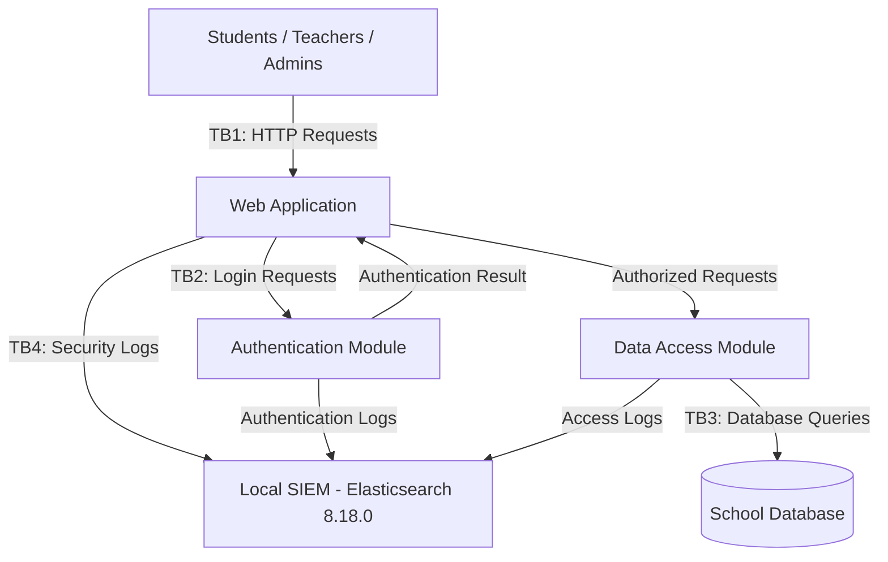

# Bright Future School Portal – Threat Model

## 1. Project Overview

The Bright Future School Portal is a fictional internal web application designed to provide secure access to school information and services.

The threat model focuses on identifying security risks within the authentication and data access modules.

**Primary objectives:**
- Protect user accounts and credentials.
- Prevent unauthorized access to school records.
- Maintain the confidentiality and integrity of information.
- Ensure availability of the portal.
- Identify and prioritize potential security threats.

## 2. System Assets

The following assets require protection:

| Asset | Description | Security Priority |
|---|---|---|
| User Credentials | Usernames and password hashes | Critical |
| Authentication Sessions | Session cookies and tokens | High |
| Student Records | Personal and academic information | Critical |
| Teacher Records | Staff information and details | High |
| User Roles | Student, teacher, and administrator permissions | Critical |
| Application Logs | Authentication and security events | High |
| Database | Stores application and school information | Critical |

## 3. System Components

The proposed portal architecture contains the following components:

1. **Users:** Students, teachers, and administrators accessing the portal.
2. **Web Application:** Processes user requests and application functionality.
3. **Authentication Module:** Verifies credentials and manages sessions.
4. **Data Access Module:** Controls access to authorized records.
5. **Database:** Stores user accounts, roles, and school records.
6. **SIEM:** Collects and analyzes security logs to identify suspicious activities.

## 4. Trust Boundaries

Trust boundaries represent points where data moves between components with different security levels.

The proposed system has four primary trust boundaries:

| Boundary | Description | Security Concern |
|---|---|---|
| TB1 – User to Web Application | Users communicate with the portal | Malicious requests and credential theft |
| TB2 – Web Application to Authentication | Login requests are processed | Credential manipulation and session attacks |
| TB3 – Application to Database | Application accesses stored records | SQL injection and unauthorized data access |
| TB4 – Application to SIEM | Security events are forwarded for monitoring | Log tampering and missing security events |

### Data Flow Diagram

*Note: This is the proposed logical architecture. The actual lab implementation will be documented separately.*

## 5. Threat Identification Using STRIDE

STRIDE is used to classify potential threats affecting the portal.

| STRIDE Category | Potential Threat | Affected Component |
|---|---|---|
| Spoofing | Attacker impersonates a legitimate user | Authentication |
| Tampering | Attacker modifies student records | Data Access |
| Repudiation | User denies performing an unauthorized action | Application Logs |
| Information Disclosure | Unauthorized exposure of student information | Database |
| Denial of Service | Attacker overwhelms the portal with requests | Web Application |
| Elevation of Privilege | Student gains administrator permissions | User Roles |

## 6. Top Five Security Risks

### Risk 1 – SQL Injection

**Description:** An attacker manipulates application input to execute unauthorized SQL queries.

- Affected asset: School database.
- STRIDE category: Tampering / Information Disclosure.
- Impact: Unauthorized access, modification, or disclosure of records.
- Severity: Critical.
- Mitigation: Parameterized queries, input validation, and least-privilege database accounts.

### Risk 2 – Broken Authentication

**Description:** Weak authentication controls allow attackers to compromise user accounts.

- Affected asset: User credentials and accounts.
- STRIDE category: Spoofing.
- Impact: Unauthorized account access and identity impersonation.
- Severity: Critical.
- Mitigation: Strong password policies, secure password hashing, login rate limiting, and multi-factor authentication.

### Risk 3 – Broken Access Control

**Description:** Users access records or functions beyond their assigned permissions.

- Affected asset: Student and teacher records.
- STRIDE category: Elevation of Privilege / Information Disclosure.
- Impact: Unauthorized access to confidential school information.
- Severity: Critical.
- Mitigation: Server-side authorization checks, role-based access control, and object-level permission validation.

### Risk 4 – Session Hijacking

**Description:** An attacker obtains or steals a valid user session token and impersonates the user.

- Affected asset: Authentication sessions.
- STRIDE category: Spoofing.
- Impact: Unauthorized access to authenticated accounts.
- Severity: High.
- Mitigation: HTTPS, Secure and HttpOnly cookies, appropriate SameSite settings, session expiration, and session rotation.

### Risk 5 – Denial of Service (DoS)

**Description:** An attacker sends excessive requests to overwhelm the application.

- Affected asset: Web application availability.
- STRIDE category: Denial of Service.
- Impact: Legitimate users cannot access the portal.
- Severity: High.
- Mitigation: Rate limiting, request validation, resource monitoring, and traffic controls.

## 7. Risk Priority Summary

| Risk | Likelihood | Impact | Priority |
|---|---|---|---|
| SQL Injection | High | Critical | Critical |
| Broken Authentication | High | Critical | Critical |
| Broken Access Control | High | Critical | Critical |
| Session Hijacking | Medium | High | High |
| Denial of Service | Medium | High | High |

*Risk ratings are preliminary qualitative assessments for this fictional lab, not results of a completed vulnerability assessment.*

## 8. Security Monitoring Requirements

The SIEM should monitor the following security events:

- Multiple failed login attempts.
- Successful logins following repeated failures.
- Suspicious authentication activity.
- Unauthorized access attempts.
- Unusual database access patterns.
- Repeated HTTP requests and suspicious traffic.
- Changes to user roles and permissions.

These events will support the development of Sigma detection rules in a later project task.

## 9. Conclusion

This threat model identifies five major security risks affecting the Bright Future School Portal.

The most critical concerns are SQL injection, broken authentication, and broken access control because they can expose sensitive information and compromise user accounts.

The identified trust boundaries and monitoring requirements will guide the lab setup, vulnerability assessment, detection engineering, and incident response activities in subsequent tasks.

---

**Document Owner:** Mubashir Ahmad  
**Project:** Secure the School Portal  
**Client:** Ezitech  
**Version:** 1.0